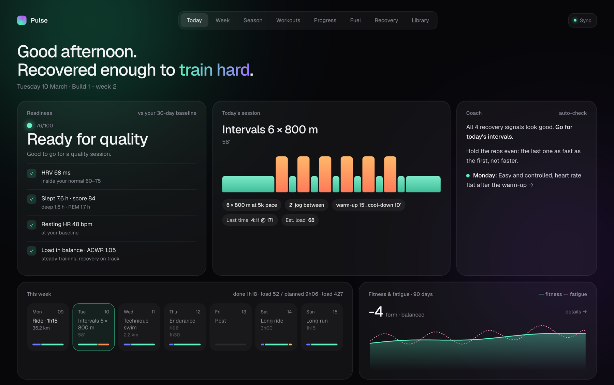

# Pulse: a training dashboard

A training dashboard for endurance training. It pulls data from Garmin and
intervals.icu, and optionally gym sessions from Notion. It shows your week, season plan, workouts, progress,
recovery and fuelling. Claude Code skills help plan weeks, analyse workouts and estimate food.

Everything runs on your own computer. Your data stays in local folders that are kept out of git.



## Setup

### What you need

- Python 3.11+ and Node.js 18+
- An [intervals.icu](https://intervals.icu) account (plan, load, fitness and zones)
- A Garmin Connect Personal API key (activities, sleep, HRV, weight)
- Optional: a Notion integration for logging gym sessions
- Optional: [Claude Code](https://claude.com/claude-code) for the planning and analysis skills

### Installation

```bash
git clone https://github.com/Anouk05/training-dashboard.git
cd training-dashboard
python3 -m venv .venv
.venv/bin/pip install -r requirements.txt
npm --prefix app/web install
cp .env.example .env
```

Fill in your keys in `.env`. Leave out the Notion lines if you don't use Notion for strength training.

### Get your data

```bash
.venv/bin/python garmin_sync.py
```

```bash
.venv/bin/python intervals_sync.py
```

```bash
.venv/bin/python notion_sync.py
```

Later syncs only fetch what's new. The **Sync** button in the dashboard runs all three.

### Start application

```bash
./start-dashboard.sh
```

Then open http://localhost:5173.

## Using it

| Page | What it's for |
|---|---|
| **Today** | Readiness (sleep, HRV, resting HR), today's sessions and a coach note |
| **Week** | Planned and completed workouts. Drag to move, click to edit, set a time of day |
| **Season** | Annual plan: periods, weekly hours and load, races |
| **Workouts** | Each workout with heart rate, power, zones, its parts of the plan and a coach report |
| **Progress** | Efficiency over time, tests, thresholds and strength |
| **Fuel** | Food log with macro targets per day, and a fuel check per workout |
| **Recovery** | Sleep, HRV and resting HR trends |
| **Library** | Your standard workouts and how often you've done them |

**Plan in intervals.icu.** Workouts you plan in intervals.icu show up on the Week page and sync to your Garmin devices. 

**To use with Claude Code**, open the folder and ask, for example:

- "plan my next week" (`plan-week` skill)
- "analyse today's ride" (`analyze-workout`; the report shows on the workout page)
- "I had 40 g oats with milk and an apple for breakfast" (`estimate-food`)
- "plan my season" (`plan-season`)

## Coaching method

The planning skills are based on Joe Friel's methods, summarised in our own words. You can add your own fuller
notes and volume tables locally; they stay out of git:

- `.claude/skills/plan-season/method.local.md` and `volume-tables.md` (weekly hours per period)
- `.claude/skills/plan-week/method.local.md` and `daily-volume.md` (daily hours per week)
- `coach/principles.local.md`

Without them, the skills use a simple built-in rule for weekly and daily volume.
